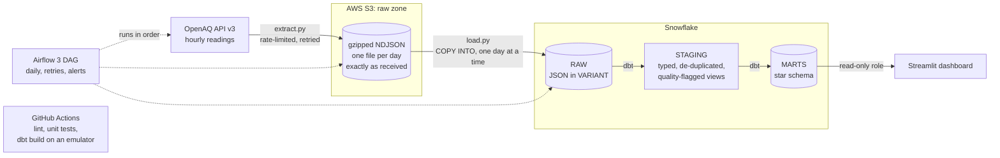
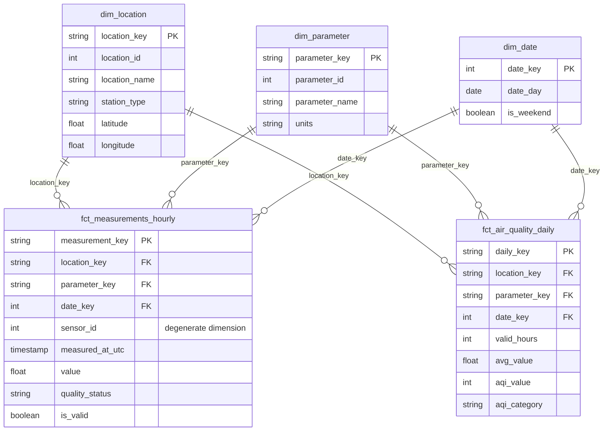

# Washington Air Quality ELT Pipeline

A daily batch pipeline that pulls hourly air quality readings for Washington
State from the [OpenAQ](https://openaq.org) API, lands them untouched in S3,
loads them into Snowflake, and models them with dbt into a tested star schema
that a Streamlit dashboard reads. Airflow runs it every day with retries and
failure alerts. GitHub Actions lints and tests every push.

## Architecture



| Stage | Tool | What happens | Why this way |
|---|---|---|---|
| Extract | Python, `requests` | One request per sensor covers the whole date window. Records are sorted into one file per UTC day. | The API allows 60 requests a minute, so the client throttles itself and backs off on errors. |
| Land | S3 | Gzipped NDJSON under `measurement_date=YYYY-MM-DD/`. Nothing is cleaned. | Raw files are the source of truth. Any cleaning rule can change later and be re-run over them. |
| Load | Snowflake `COPY INTO` | Each day is deleted and re-copied in one transaction, into a `VARIANT` column. | Re-running a day gives the same rows as running it once. A new API field never breaks the load. |
| Transform | dbt | Staging views cast and de-duplicate. Marts build one fact table, three dimensions and a daily summary. | All business logic is version-controlled SQL with tests next to it. |
| Orchestrate | Airflow 3 | `resolve_window → extract → load → dbt_source_freshness → dbt_build` | Retries with backoff for network steps, a webhook alert when retries run out. |
| Serve | Streamlit | Reads the daily summary through a role that can only `SELECT` from `MARTS`. | Runs in Docker next to everything else. |
| CI | GitHub Actions | Ruff, pytest, DAG integrity tests, and a full `dbt build` against a local Snowflake emulator. | No secrets needed, so it works on forks and after a trial account expires. |

The reasoning behind each choice, and the alternatives it beat, is in
[docs/design-decisions.md](docs/design-decisions.md).

## Data model



- **`fct_measurements_hourly`**: one row per sensor per hour. Every reading is
  kept, good or bad, with a `quality_status` saying which. Incremental.
- **`fct_air_quality_daily`**: one row per location, pollutant and local day,
  averaged over valid hours only, with a US EPA AQI category for PM2.5.
- **Dimensions**: where (`dim_location`), what (`dim_parameter`), when
  (`dim_date`).

## Run it

**Without any cloud account** (about five minutes). This runs the linter, the
unit tests, and every dbt model and test against a local Snowflake emulator:

```bash
make init     # creates .env and local folders
make venv     # Python tools into .venv
make check    # lint + unit tests + dbt build on the emulator
```

**The real pipeline** needs a free OpenAQ key, an S3 bucket and a Snowflake
trial. [docs/setup.md](docs/setup.md) goes through it step by step and says
before each step whether it can cost anything. Once `.env` is filled in:

```bash
make up                                        # Airflow on :8080, dashboard on :8501
make backfill START=2026-09-01 END=2026-09-30  # first load
make unpause                                   # turn the daily schedule on
make stats                                     # the numbers below, from your warehouse
```

Run `make` on its own to list every command.

## Tests

| Layer | What is checked | Where |
|---|---|---|
| Extract and load | Pagination, rate-limit handling, retries, window filtering, idempotent reload, rollback on failure. 41 tests, no network. | `tests/` |
| dbt data tests | Uniqueness, not-null, foreign keys to every dimension, accepted values, ranges, hourly-to-daily reconciliation. 78 tests. | `dbt/models/**/*.yml`, `dbt/tests/` |
| dbt unit tests | The quality rules and the AQI calculation, on hand-written rows with known answers. 2 tests. | same YAML files |
| Idempotency | CI re-loads a day with one corrected value and rebuilds: the row count must not change and the correction must arrive. | `scripts/dbt_emulator.py` |
| Orchestration | The DAG imports under Airflow 3, tasks are wired in order, every task has retries and an alert. 6 tests. | `tests/dags/` |

## Numbers

Fill these in from `make stats` and the Airflow UI once your pipeline has run
for a few days. Only quote numbers you measured.

| Metric | Value |
|---|---|
| Raw rows loaded per day | _from `make stats`_ |
| Stations and sensors reporting | _from `make stats`_ |
| Readings passing quality checks | _from `make stats`_ |
| End-to-end run time (median of scheduled runs) | _from the Airflow UI_ |
| dbt models / tests | 9 models, 80 tests |

## Project layout

```
pipeline/     extract.py, load.py and the OpenAQ client
dags/         the Airflow DAG
dbt/          models (staging, intermediate, marts), seeds, tests, macros
snowflake/    one-time setup SQL: roles, warehouse, storage integration, raw tables
dashboard/    the Streamlit app
scripts/      dbt_emulator.py (CI), pipeline_stats.py (make stats)
tests/        Python unit tests and DAG integrity tests
docs/         setup guide, design decisions, interview prep
```

## Known limitations

- **The bounding box is not the state border.** A few stations just across the
  Oregon and Idaho lines are included. A proper fix is a point-in-polygon test
  against the state boundary.
- **Late data is handled by re-pulling, not by event time.** Each run re-loads
  the last two UTC days. A reading that arrives later than that is only picked
  up by a manual backfill.
- **Dimensions are overwritten, not versioned.** If a station is renamed, old
  facts show the new name. A dbt snapshot would add history (SCD type 2).
- **Rows deleted upstream stay in the fact table** until a `--full-refresh`,
  because the incremental model only inserts and updates.
- **AQI here is not official.** It applies the EPA breakpoints to a daily mean
  for comparison between days and places. AirNow's published values use a
  different averaging method.
- **CI uses an emulator.** It proves the SQL runs and the tests pass on known
  data, not that real Snowflake behaves identically. `make dbt-build` against a
  real account is the final check.

## Data source

Air quality data from [OpenAQ](https://openaq.org), which aggregates
measurements from government monitors and other providers. Use of the data is
subject to the [OpenAQ terms](https://docs.openaq.org/about/terms) and the
licenses of the original providers.
